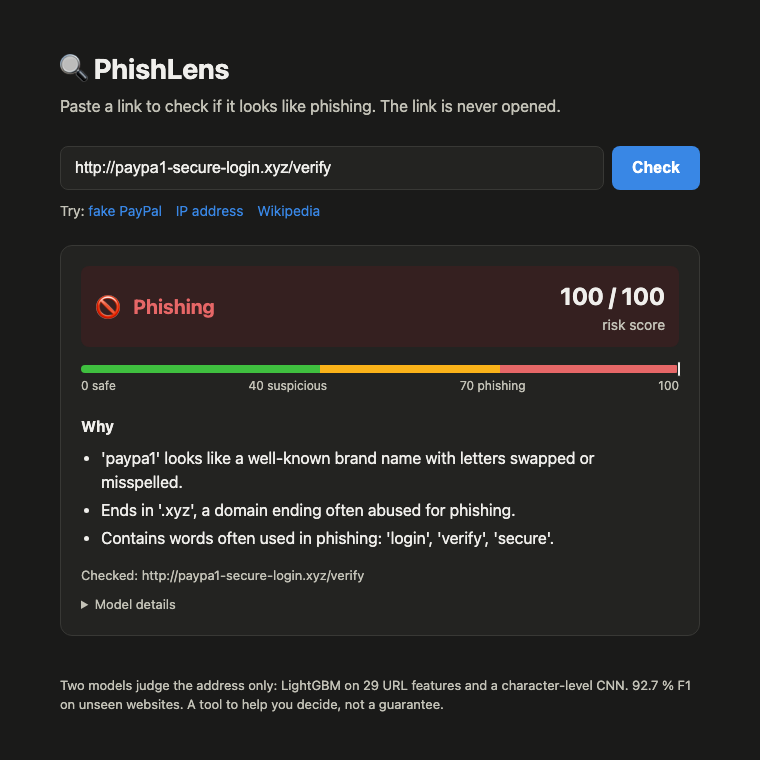
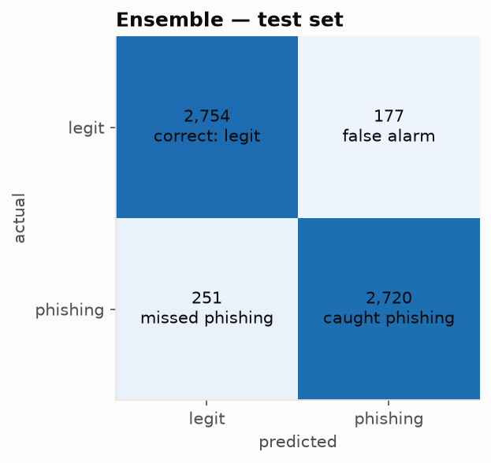
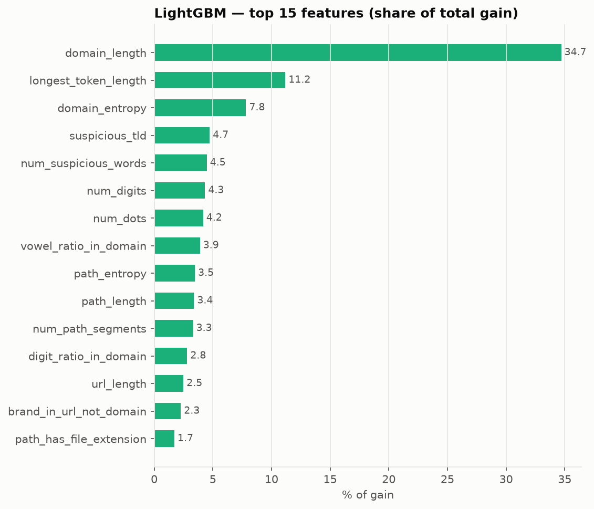

# PhishLens

**Real-time phishing URL detection with an explainable LightGBM + CNN ensemble.**

Paste a link and PhishLens says whether it looks like phishing, gives a risk score from 0 to 100,
and explains **why** in plain English. The link is never opened: only the text of the address is
analysed, so checking a dangerous link is safe, and each check takes about 4 ms.



## Results

Measured on **5,902 URLs from websites the models never saw during training** (split by website):

| Model | Accuracy | Precision | Recall | F1 | False-positive rate |
|---|---|---|---|---|---|
| LightGBM (29 features) | 89.1 % | 89.3 % | 88.9 % | 89.1 % | 10.7 % |
| Char-CNN (raw characters) | 91.8 % | 93.1 % | 90.4 % | 91.7 % | 6.8 % |
| **Ensemble (50 / 50)** | **92.7 %** | **93.9 %** | **91.6 %** | **92.7 %** | **6.0 %** |

The ensemble beats both models on every metric: the two models make different mistakes.

These scores are lower than the 97–99 % often reported for URL datasets, and that is deliberate.
The data was audited for **collection shortcuts** (e.g. legit URLs collected as `https://` homepages
and phishing URLs as long `http://` paths), and these were removed. Websites never appear in both
training and test, so the score reflects how the model judges new sites, not how well it remembers
known ones.



## How it works

```
                 ┌─► 29 URL features ─► LightGBM ──┐
URL ─► clean ────┤                                 ├─► 0.5 × p1 + 0.5 × p2 ─► risk score 0-100
                 └─► 200 character ids ─► Char-CNN ┘            │              + level + reasons
                                                     (weight chosen on the validation set)
```

1. **Clean:** the URL is normalised: lower-case host, default ports and fragments removed,
   non-ASCII characters encoded. Training and the app share this code, so a URL is processed the
   same way in both.
2. **Two models, two views of the URL:**
   - **LightGBM** on 29 hand-made features: lengths, digits, subdomains, suspicious TLDs, brand
     names on the wrong domain (`paypal` on `evil.xyz`), brand look-alikes (`paypa1`, `rnicrosoft`),
     IP hosts, `@` tricks, randomness (entropy) and more.
   - **Character-level CNN** (PyTorch, exported to ONNX): reads the raw URL and learns its own
     patterns.
3. **Soft voting:** the two probabilities are averaged with weight 0.5, which gave the best F1 of
   {0.3 … 0.7} on the validation set.
4. **Risk level:** 0–39 *Looks safe* · 40–69 *Suspicious* · 70–100 *Phishing*.
5. **Reasons:** red-flag rules ordered by their per-URL **SHAP** contribution, so only signs that
   actually raised this URL's score are shown. Definite tricks (IP host, `@`, look-alikes,
   shorteners) are always listed first.

## Data

40,000 URLs, balanced 20,000 / 20,000, from about 19,000 websites:

| Class | Source |
|---|---|
| Phishing | [OpenPhish](https://openphish.com) feed + [Phishing.Database](https://github.com/Phishing-Database/Phishing.Database) active links (capped per host and per site) |
| Legit | Homepages and internal links crawled from [Tranco](https://tranco-list.eu) top sites (top 10k + long tail up to rank 200k), respecting `robots.txt` |

Legit links were **crawled** rather than using bare domains, so legit URLs also have paths. Without
this, a model learns "short URL = legit". Split: 70 / 15 / 15 **grouped by website**.
The dataset itself is not stored in this repository; `scripts/build_dataset.py` rebuilds it.

## Model choice

| Model (validation set, 29 features) | F1 |
|---|---|
| Logistic Regression | 88.8 % |
| Decision Tree | 86.2 % |
| Random Forest | 89.8 % |
| **LightGBM** | **90.3 %** |

The learning curve is flat (89.5 % → 90.3 % F1 from 25 % to 100 % of the training data): more data
of the same kind would not help much, so the limit is the features. The Char-CNN adds a second
view of the URL and lifts F1 from 89–90 % to 92.7 %.



## API

```bash
curl -X POST https://<your-app>.onrender.com/api/check \
     -H "Content-Type: application/json" \
     -d '{"url": "http://paypal.com@evil-site.top/login"}'
```
```json
{
  "url": "http://paypal.com@evil-site.top/login",
  "risk_score": 100,
  "risk_level": "Phishing",
  "reasons": [
    "Contains '@': browsers ignore everything before it, hiding the real site.",
    "Ends in '.top', a domain ending often abused for phishing.",
    "Mentions 'paypal', but the website (evil-site.top) does not belong to that brand."
  ],
  "model_scores": {"lightgbm": 0.9961, "cnn": 1.0}
}
```
`GET /health` returns `{"status": "ok"}`; interactive API docs are at `/docs`.

## Run it

```bash
# requirements: uv (https://docs.astral.sh/uv/), Python 3.12 is installed by uv
uv sync                                   # install everything (exact versions from uv.lock)
uv run pytest                             # 101 tests
uv run uvicorn app.main:app --reload      # open http://127.0.0.1:8000
```

With Docker (production image, no PyTorch):
```bash
docker build -t phishlens .
docker run -p 8000:8000 phishlens
```

Rebuild the data and models from scratch:
```bash
uv run python scripts/build_dataset.py all    # download feeds + crawl legit sites (~15 min)
uv run python -m phishlens.benchmark          # 4-model comparison + learning curve
uv run python -m phishlens.train              # final models, test evaluation, export (~75 s)
```

## Project structure

```
src/phishlens/
  urls.py            URL cleaning, shared by every step
  features.py        URL -> 29 features
  char_encoding.py   URL -> 200 character ids
  data.py            load + split by website
  benchmark.py       4-model comparison + learning curve
  charcnn.py         CNN definition, training, ONNX export
  train.py           final models, voting weight, test evaluation, export
  evaluate.py        metrics and charts
  reasons.py         plain-English reasons
  predict.py         loads models/ and scores a URL (used by the app)
app/main.py          FastAPI: /, /health, /api/check
app/static/          web page (plain HTML + JavaScript)
scripts/             dataset builder
models/              lightgbm.joblib, charcnn.onnx, config.json
notebooks/eda.ipynb  data exploration
docs/REPORT.md       full project report: every decision and its reason
```

## Limitations

- **URL only.** Phishing on hacked legitimate sites, or on user-content pages of big platforms
  (Google Forms, Sites), can look like a normal URL.
- **Real login pages can be flagged.** The legit training links come from homepages, which rarely
  link to login pages, so `login` appears mostly in phishing URLs. For example,
  `login.microsoftonline.com` scores high. The model's result is always shown as it is; there is
  no hidden allow-list.
- **Free hosting.** Few legit user sites on free hosts (`*.github.io`, `*.weebly.com`) are in the
  data, so such sites tend to score *Suspicious*.
- Feeds contain some noise (dead or mislabelled URLs).

Full details, the bias audit and every design decision are in [docs/REPORT.md](docs/REPORT.md).

## Tech stack

Python 3.12 · pandas · scikit-learn · LightGBM · PyTorch (training only) · ONNX Runtime ·
FastAPI · Docker · uv · pytest · ruff
