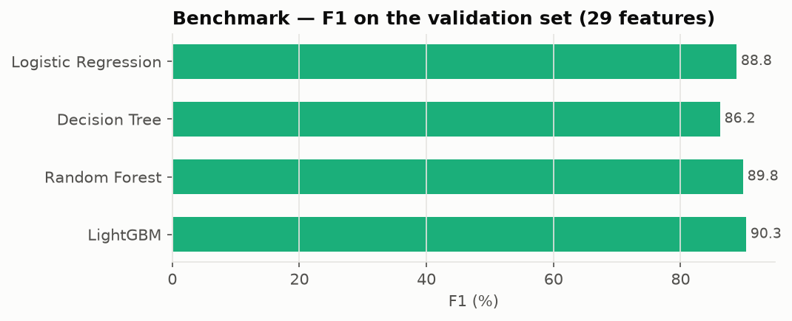
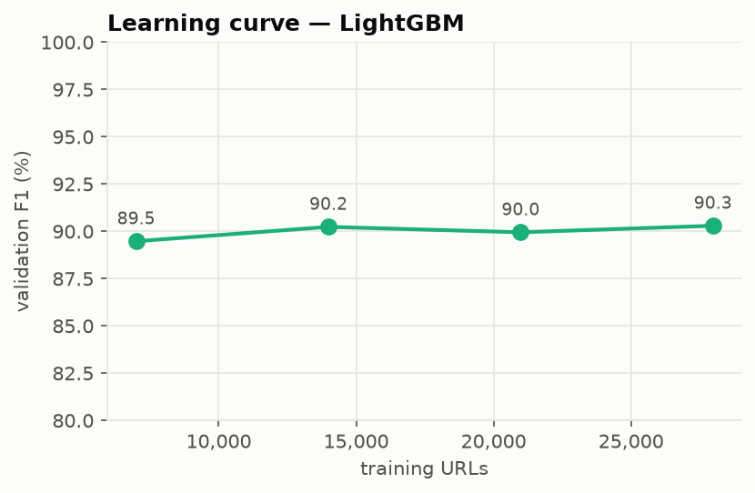
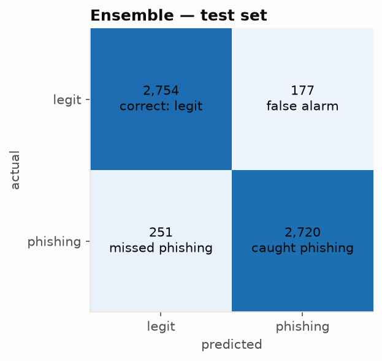
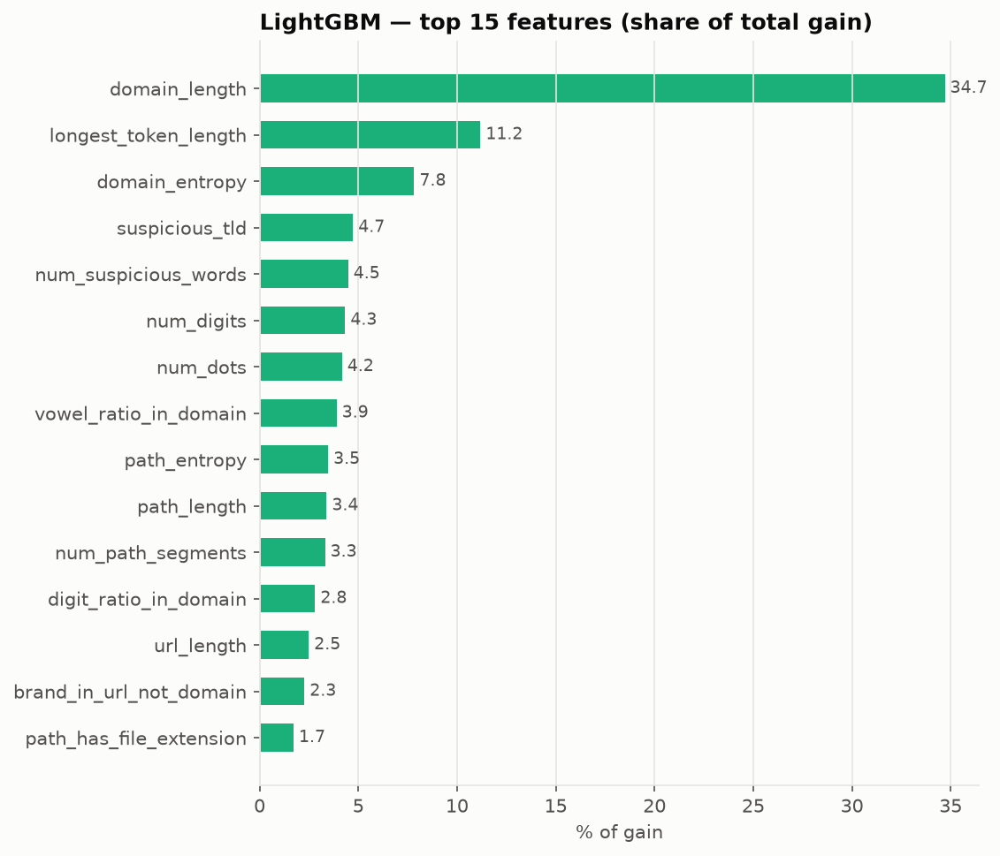
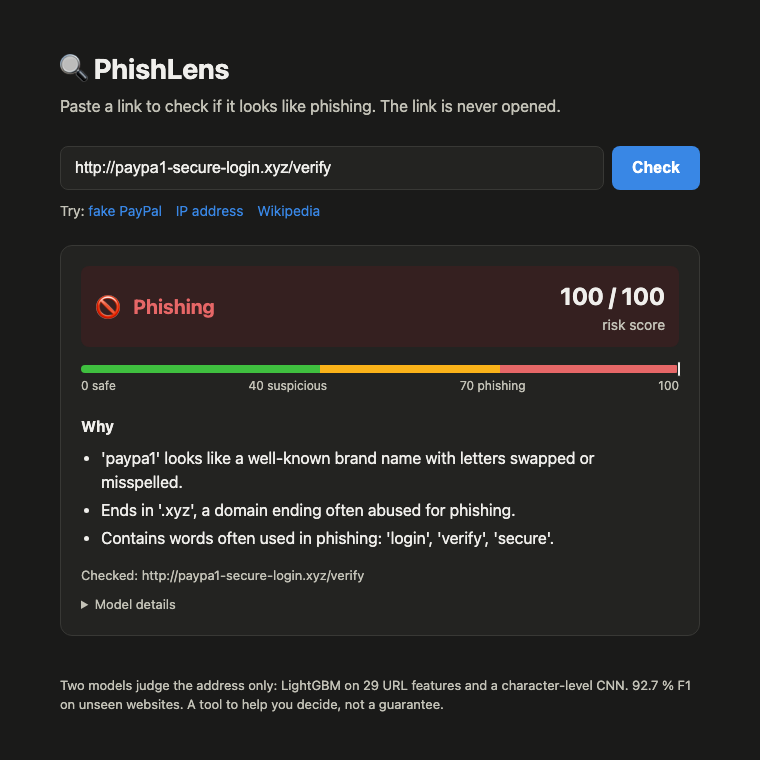
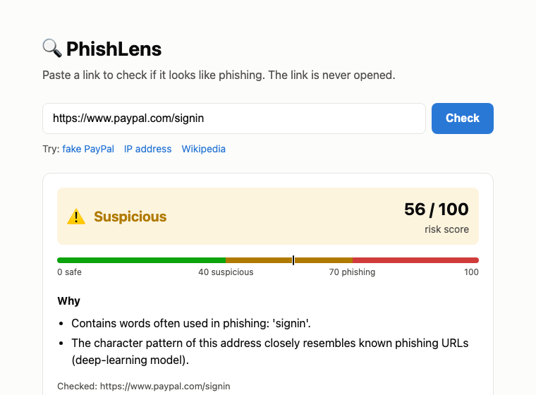

# PhishLens — Project Report

*Living document, updated at the end of every phase.*
*Last updated: 2026-11-05 (Phases 0–1 complete, data audit closed).*

---

## 1. Introduction

### 1.1 Problem
Phishing is a cyber-attack in which a fake website imitates a trusted one (a bank, a delivery
company, a social network) to steal passwords or payment details. The victim usually reaches the
fake site by clicking a link in an e-mail, SMS or chat message. Detecting a phishing **URL**
before the page is opened is a cheap, fast first line of defence.

### 1.2 Objective
Build a real-time phishing URL detector that:
1. classifies a URL as **safe / suspicious / phishing** with a risk score (0–100),
2. explains **why** (top reasons),
3. works from the URL text alone (fast, and the server never visits a dangerous site),
4. is deployed as a live web application.

### 1.3 Approach (summary)
Supervised binary classification. Two different models look at the same URL in different ways
and their outputs are combined by **soft weighted voting**:
- **LightGBM** (gradient-boosted decision trees) on **29 hand-engineered features**,
- a **character-level CNN** (convolutional neural network) on the raw URL text.

### 1.4 Scope and constraints
- URL text only: no WHOIS, DNS or page-content checks (possible future work).
- Built as a fresher-level project: every component must be explainable in an interview.
- Free tooling and free hosting only.

---

## 2. Tools and environment (Phase 0)

| Area | Choice | Reason |
|---|---|---|
| Language | Python 3.12 | Widely supported by ML libraries (3.14 too new) |
| Environment | `uv` + virtual environment, locked versions (`uv.lock`) | Reproducible installs |
| Data | pandas, numpy, tldextract | Tabular data handling, correct domain splitting |
| ML | scikit-learn, LightGBM, PyTorch (training only), ONNX Runtime (serving) | Industry standard; small production image |
| Collection | requests, BeautifulSoup | Downloading feeds, parsing HTML for links |
| Analysis | matplotlib, Jupyter | EDA charts |
| Quality | pytest, ruff | Tests and code style |
| Hardware | Apple M5, 16 GB RAM (GPU via PyTorch MPS) | Sufficient; no cloud GPU needed |

Libraries are split into **runtime** (needed by the live app) and **dev** (training, crawling,
analysis) groups so the production image stays small enough for a free host.

---

## 3. Data collection (Phase 1)

### 3.1 Sources

| # | Source | Class | What it provides | Used |
|---|---|---|---|---|
| 1 | OpenPhish community feed | Phishing | ~300 live, verified phishing URLs | All (279 after cleaning/caps) |
| 2 | Phishing.Database (GitHub) | Phishing | 789,054 known active phishing URLs | Random capped sample (19,721) |
| 3 | Tranco top-1M list | Legit | Ranked list of popular **domain names** (no paths) | 7,000 sites chosen for crawling |
| 4 | Own crawl of Tranco sites | Legit | Homepage + internal links **with real paths** | 20,000 sampled |

### 3.2 Why a crawler was necessary
A domain list contains only names (`github.com`), while phishing URLs have long paths. Training on
that would let a model learn the shortcut *"has a path / is long ⇒ phishing"*. A public reference
project (PhishX) was found to have exactly this problem: **0 %** of its legit URLs had a path,
against 66 % of its phishing URLs. To avoid it, legit URLs were collected by visiting real sites.

### 3.3 Crawl method
- 7,000 sites: 3,000 random from Tranco ranks 1–10,000 (popular) + 4,000 random from ranks
  10,001–200,000 (smaller sites), so "legit" is not only big brands.
- Per site: `robots.txt` is checked first; then only the homepage is fetched (2 requests per
  site, never deeper). Up to 10 **internal** links are kept per site.
- The bot identifies itself with an honest User-Agent; 32 sites crawled in parallel; results
  are written incrementally and the crawl can resume after interruption.
- Result: **3,924 of 7,000 sites responded** (others blocked bots, had no homepage, or timed
  out); ~36,000 legit URLs collected in ~15 minutes.

### 3.4 Cleaning and sampling
1. **Normalisation** (`normalize_url`): trim whitespace, add a missing scheme, keep only
   http/https, lowercase scheme and host, remove default ports (`:443`, `:80`), reject
   `mailto:`/`javascript:`/invalid URLs.
2. **De-duplication.**
3. **Phishing sampling:** Phishing.Database is alphabetically sorted, so it is **shuffled**
   before sampling; caps of **3 URLs per host** and **200 per website** stop single campaigns or
   free hosts from dominating.
4. **Balancing:** 20,000 per class.
5. **Contradictions removed:** any URL present in both classes is dropped.
6. **`domain` column** added (registered domain, e.g. `login.paypal.co.uk → paypal.co.uk`) for
   splitting train/test by website later.
7. Fixed random seed (42) everywhere → the dataset is fully reproducible.

### 3.5 Final dataset

| Source | URLs | Label |
|---|---|---|
| Phishing.Database | 19,721 | phishing |
| OpenPhish | 279 | phishing |
| Crawled links | 17,836 | legit |
| Crawled homepages | 2,164 | legit |
| **Total** | **40,000** | 50 / 50 |

19,121 distinct websites (legit ≈ 3,600, phishing ≈ 15,500); only 8 websites contain both classes.

---

## 4. Exploratory data analysis (Phase 1)

Full notebook: `notebooks/eda.ipynb`. Charts: `docs/images/`.
All measurements use the model's view of a URL (no scheme, no `www.`).

### 4.1 Collection-bias check
A *collection bias* is a difference between classes caused by how the data was gathered rather
than by phishing itself. A model would learn it as a shortcut that fails in the real world.

| Property | Legit | Phishing | Assessment |
|---|---|---|---|
| Has a path or query | 87.6 % | 72.4 % | ✅ Shortcut removed by crawling |
| Median length | 32 chars | 43 chars | ✅ Real difference, distributions overlap heavily |
| Uses `http://` (not https) | 0.9 % | 23.8 % | ⚠️ Artefact: crawler started every site at https → hidden from models |
| Starts with `www.` | 51.0 % | 8.7 % | ⚠️ Artefact of site conventions → hidden from models |
| Default port `:443` | 2.4 % → **0 %** | 0.2 % | ⚠️ Artefact from redirects → fixed in normalisation |
| Ends with `/` | 39.4 % → **0.06 %** | 0.9 % → 0 % | 🚨 Artefact: feeds strip it, sites keep it → removed in normalisation |
| Non-ASCII characters | 0.6 % → **0 %** | 0 % | ⚠️ Artefact: feeds store encoded URLs → %-encoding / punycode in normalisation |
| `#fragment` | 0 % | 0.04 % → 0 % | ⚠️ Artefact: crawler dropped it → dropped everywhere; feature `has_fragment` replaced by `is_homepage` |
| Free hosting / site builders | 0.1 % | 22.4 % | 🚨 Partly artefact: Tranco lists only main domains, never user sites (`someone.weebly.com`) → see §11.2 |
| Has `?query` | 7.2 % | 18.5 % | 🟡 Partly artefact (homepage navigation links rarely have queries) → documented, monitored |
| `.php` / `.html` path | 10.0 % | 33.0 % | ✅ Real (phishing kits are mostly PHP) |
| Bare homepage | 12.4 % | 27.6 % | ✅ Real (many phishing sites live at the root) |

### 4.2 Findings

| Finding | Numbers | Use in features |
|---|---|---|
| Suspicious words far more frequent in phishing | `login` 10.4 % vs 0.7 %; `verify`, `confirm`, `wallet` ≈ 0 % in legit | `num_suspicious_words` |
| Many more digits | mean 10.5 vs 2.0 per URL | `num_digits`, `digit_ratio_in_domain` |
| More subdomains | mean 0.7 vs 0.1 | `num_subdomains` |
| Cheap / new TLDs lean phishing | `.dev .app .io .top .xyz` | `suspicious_tld` |
| Brand impersonation | 14.7 % of phishing vs 1.1 % of legit mention a brand on a non-brand site | `brand_in_url_not_domain`, `brand_lookalike` |
| Length overlaps, phishing long tail | 4.9 % of phishing > 200 chars | `url_length`, `path_length` |
| **Legit has more hyphens** (path slugs like `/pasta-recipes`) | 1.7 vs 1.1 | changed to `num_hyphens_in_domain` |
| Rare but one-sided flags | IP host 1.2 % vs 0 %; `@` 2.0 % vs 0.03 % | `has_ip`, `has_at` |
| Weak signals | punycode, %-encoding similar in both classes | kept; model decides |
| Phishing relies on free hosting | 000webhostapp, weebly, gitbook, godaddysites | known limitation |

---

## 5. Feature engineering (Phase 2)

Code: `src/phishlens/features.py` (LightGBM), `src/phishlens/char_encoding.py` (Char-CNN),
tests in `tests/test_features.py`. Both modules call `normalize_url()` and `model_input()` from
`urls.py`, so training and the live app compute inputs with identical code (D8), and the scheme
and `www.` are invisible to both models (D3).

### 5.1 The 29 features
| Group | Features |
|---|---|
| Size and counts | url_length, domain_length, path_length, num_dots, num_hyphens_in_domain, num_digits, num_path_segments, num_query_params, num_special_chars |
| Tricks in the address | has_at, has_ip, https_in_domain, has_port, has_double_slash_in_path, path_has_file_extension, num_subdomains |
| Domain reputation (fixed lists) | suspicious_tld, is_shortener, has_punycode |
| Words and brands | num_suspicious_words, brand_in_url_not_domain, brand_lookalike |
| Randomness / unusual text | domain_entropy, digit_ratio_in_domain, longest_token_length, path_entropy, percent_encoded_ratio, vowel_ratio_in_domain, is_homepage |

Design choices:
- **Word lists come from public knowledge, not from our data** (abused-TLD reports, commonly
  impersonated brands, URL shorteners). A list built by reading our own phishing URLs would
  memorise the dataset and inflate test scores. For the same reason `.dev`, `.app` and `.io` are
  *not* in the suspicious-TLD list: in our data they lean phishing only because of free hosting
  (§11.2).
- **Brands are matched as whole tokens**: "chase" inside "purchase" or "apple" inside
  "pineapple" does not count. A brand on its own site (`paypal.co.uk`) or own TLD
  (`research.google`) does not count either.
- **Look-alikes** (`paypa1`, `rnicrosoft`, `faceb00k`, `netfllx`): character swaps (0→o, 1→l,
  rn→m, vv→w…) or one typo away from a brand. The typo rule is limited to brands of 6+ letters
  with the same first letter, after tests showed false matches such as `apply`→apple,
  `cloud`→icloud and `finance`→binance.
- **Hyphens are counted in the domain only** (D7).

### 5.2 Character encoding for the Char-CNN
The URL (after `model_input()`, lowercased) becomes 200 integer ids: 68 known characters
(a–z, 0–9, 32 punctuation marks) get ids 2–69, 0 = padding, 1 = unknown. Longer URLs are cut.
On the dataset: 0 unknown characters (normalisation makes every URL ASCII) and 2.7 % of URLs are
longer than 200 characters.

### 5.3 Sanity check on the 40,000 URLs
All 40,000 URLs are processed in about 1 s (≈ 26 µs per URL), with no missing values.
Average value per class (selection):

| Feature | Legit | Phishing |
|---|---|---|
| url_length | 41.0 | 65.5 |
| domain_length | 13.0 | 24.1 |
| num_digits | 2.3 | 10.8 |
| num_hyphens_in_domain | 0.07 | 0.65 |
| num_subdomains | 0.10 | 0.47 |
| longest_token_length | 10.1 | 22.8 |
| path_has_file_extension | 10.2 % | 33.5 % |
| suspicious_tld | 0.8 % | 12.0 % |
| brand_in_url_not_domain | 0.9 % | 10.6 % |
| num_suspicious_words | 0.02 | 0.27 |
| brand_lookalike | 0 % | 0.6 % |
| has_ip / has_at | 0 % / 0 % | 1.1 % / 2.0 % |
| path_length | 25.3 | 23.9 |
| percent_encoded_ratio | 0.012 | 0.002 |

Observations:
- The directions match the EDA (Section 4.2) → the features measure what they are meant to.
- **path_length is almost equal** in both classes: the crawl removed the length shortcut (D2).
- **percent_encoded_ratio is higher for legit** URLs (non-English article slugs such as
  `/caf%C3%A9`). Plausibly real, but watched in Phase 3 feature importance.
- `is_shortener`, `has_punycode`, `https_in_domain`, `has_port` are almost never 1 in either
  class: little help in training, kept because they matter for live URLs.
- Remaining false positive seen: a legit page *about* a brand (`eneba.com/store/amazon-gift-cards`)
  triggers brand_in_url_not_domain. Expected; the model weighs it together with other features.

---

## 6. Models and evaluation (Phase 3)

Code: `data.py` (split), `benchmark.py`, `charcnn.py`, `train.py`, `evaluate.py`, `predict.py`
in `src/phishlens/`. Full numbers: `docs/results/benchmark.md`, `docs/results/results.md`,
`docs/results/metrics.json`. Run: `uv run python -m phishlens.benchmark` and
`uv run python -m phishlens.train` (≈ 75 s in total on an Apple M5).

### 6.1 Split
Split **by website** (`domain` column, `GroupShuffleSplit`): train 27,978 · validation 6,120 ·
test 5,902 URLs. No website appears in two parts (checked by an assertion). Roles:
- **train**: models learn from it;
- **validation**: every choice (early stopping, voting weight, model comparison);
- **test**: used **once**, at the end, for the reported score.

### 6.2 Benchmark: why LightGBM (validation set, 29 features)
| Model | Accuracy | Precision | Recall | F1 | FPR |
|---|---|---|---|---|---|
| Logistic Regression | 88.6 % | 92.1 % | 85.7 % | 88.8 % | 8.2 % |
| Decision Tree | 86.2 % | 90.8 % | 82.0 % | 86.2 % | 9.2 % |
| Random Forest | 89.4 % | 90.6 % | 89.0 % | 89.8 % | 10.2 % |
| **LightGBM** | **90.0 %** | 92.0 % | 88.6 % | **90.3 %** | 8.5 % |



LightGBM is best, but only slightly: on these features all models are close. That points to
the **features** as the limit, not the algorithm.

**Learning curve** (LightGBM, 25 → 100 % of the training data): F1 89.5 → 90.2 → 90.0 → 90.3 %.
The curve is flat: **more URLs of the same kind would not help LightGBM much**. This answers the
question in §11.5 with evidence, and is the reason for adding a second model that reads the URL
differently.



### 6.3 Final models
- **LightGBM**: learning rate 0.05, up to 2,000 trees, early stopping on validation → 293 trees.
- **Char-CNN** (PyTorch, trained on the Apple GPU via MPS): character embedding (32) → three
  convolutions (windows of 3, 4, 5 characters, 128 filters each) → max-pool → dropout 0.5 → 1
  output. Adam, batch 256, early stopping (patience 3) → stopped after 24 epochs, best epoch kept.
- **Voting weight** `final = w × LightGBM + (1 − w) × CNN`, chosen on validation F1:

| w | 0.3 | 0.4 | **0.5** | 0.6 | 0.7 |
|---|---|---|---|---|---|
| Validation F1 | 93.35 % | 93.90 % | **94.11 %** | 93.37 % | 92.17 % |

### 6.4 Test-set results (reported once)
| Model | Accuracy | Precision | Recall | F1 | FPR |
|---|---|---|---|---|---|
| LightGBM | 89.1 % | 89.3 % | 88.9 % | 89.1 % | 10.7 % |
| Char-CNN | 91.8 % | 93.1 % | 90.4 % | 91.7 % | 6.8 % |
| **Ensemble (w = 0.5)** | **92.7 %** | **93.9 %** | **91.6 %** | **92.7 %** | **6.0 %** |



- The ensemble beats both models on **every** metric: the two models make different mistakes,
  so averaging them cancels part of the errors.
- The CNN alone is better than LightGBM: it sees patterns the 29 hand-made features do not.
- These numbers are **lower than the 97–99 % often reported** for URL datasets, by design: the
  collection shortcuts were removed (§4.1, §11.3) and websites never cross the split, so the score
  is closer to what the model can actually do.

**Risk zones on the test set** (ensemble):

| Actual | Looks safe (0–39) | Suspicious (40–69) | Phishing (70–100) |
|---|---|---|---|
| legit | 88.9 % | 8.7 % | 2.4 % |
| phishing | 5.4 % | 11.1 % | 83.5 % |

Only 2.4 % of legit URLs get the red "Phishing" label; the middle zone catches most of the
uncertain cases. The default zone limits (40 / 70) were kept.

### 6.5 What LightGBM relies on


Top features: domain_length (35 % of gain), longest_token_length, domain_entropy,
suspicious_tld, num_suspicious_words. Long, random-looking domains are the strongest signal.
**Caution:** part of domain_length may reflect free hosting (`pub-8b4c….r2.dev`), the documented
imbalance of §11.2. Rarely-firing features (has_at, has_ip, brand_lookalike) have low gain because
they are rare, not because they are weak when they do fire.

### 6.6 Export and checks
- `models/lightgbm.joblib` (1.0 MB), `models/charcnn.onnx` (0.2 MB), `models/config.json`
  (weight, zones, feature names, importance).
- The ONNX model gives the same probabilities as PyTorch (max difference 5 × 10⁻⁷), so the app
  can run the CNN with ONNX Runtime and no PyTorch.
- `predict.py` loads exactly these files; the tricky-URL test below runs through it.

### 6.7 Hand-picked tricky URLs (made up, not in the dataset)
All 8 phishing-style URLs score 70–100, and plain pages of legit sites score low. The weak spot is
**real login pages of big sites**:

| URL | Risk | Level |
|---|---|---|
| `https://accounts.google.com/signin` | 23 | Looks safe |
| `https://www.paypal.com/signin` | 56 | Suspicious |
| `https://github.com/login` | 58 | Suspicious |
| `https://login.microsoftonline.com` | 88 | Phishing ❌ |
| `https://www.onlinesbi.sbi/personal/login.html` | 92 | Phishing ❌ |
| `https://someone.github.io/portfolio` | 56 | Suspicious (free hosting, §11.2) |

Why: the crawler collected links from **homepages**, which are rarely login pages, so in our
training data "login" appears almost only in phishing URLs. A URL-only model also cannot know that
`microsoftonline.com` belongs to Microsoft. Real products handle this with a list of known,
trusted sites in front of the model. **Not done here (D15):** a URL on a trusted website can still
be phishing (user content such as Google Forms, hacked pages, redirect links, abandoned
subdomains), so the app always shows the model's own result. The weakness stays documented (§12).

### 6.8 Engineering note: LightGBM + PyTorch on macOS
Both libraries ship their own OpenMP (threading) library. In one process they clash: PyTorch's
CPU code froze after LightGBM had run (the first training run hung in the ONNX export), and
loading a LightGBM model crashed after PyTorch was imported. Fixes: the export runs PyTorch on one
thread, and `tests/conftest.py` imports LightGBM first. The deployed app is not affected because
it never loads PyTorch.

---

## 7. Explanations (Phase 4)

Code: `src/phishlens/reasons.py`, used by `predict.py`; tests in `tests/test_reasons.py`.
Every result comes with **up to 3 plain-English reasons**.

### 7.1 How reasons are chosen
1. **Red-flag rules:** 19 rules, one per feature. Each rule says when its feature is a red flag
   and writes a specific message, naming the actual brand, TLD, words or file type.
   "Unusually long / many" limits are set at the **95th percentile of legit training URLs**
   (e.g. domain longer than 21 characters, longest token longer than 16), so a flag means
   "rarer than 95 % of real websites".
2. **Ordered by what mattered for this URL:** LightGBM gives the push of every feature on this
   one URL's score (SHAP contributions, `pred_contrib=True`). Red flags are sorted by that push,
   and flags that pushed this URL **towards legit** are left out. So a reason is only shown if
   it really raised this URL's score. This is more faithful than one global importance ranking
   (§6.5), which is the same for every URL.
3. **Known tricks first:** IP address host, `@`, brand look-alike, shortener, punycode and
   `https` inside the name are rare in the training data (e.g. shorteners 0 %), so LightGBM
   gives them little weight. Each one is still a definite, well-known trick, so it is always
   listed first when present. This was added after testing: the first version showed "full of
   digits" instead of "raw IP address" for `http://192.168.10.5/...`.
4. **The CNN's share:** the Char-CNN cannot point to single features. When it is confident
   (probability ≥ 0.7) and there is room, a general reason is added: *"The character pattern of
   this address closely resembles known phishing URLs."*
5. **Safe zone (score < 40):** "No strong phishing signs found", unless a known trick is
   present, which is always mentioned.

### 7.2 Examples
| URL (made up) | Risk | Reasons |
|---|---|---|
| `http://paypa1-secure-login.xyz/verify` | 100 | 'paypa1' looks like a brand name · ends in '.xyz' · words 'login', 'verify', 'secure' |
| `http://192.168.10.5/wellsfargo/login.php` | 100 | raw IP address · mentions 'wellsfargo' on someone else's site · word 'login' |
| `http://paypal.com@evil-site.top/login` | 100 | '@' hides the real site · ends in '.top' · mentions 'paypal' |
| `https://bit.ly/3xYz9Ab` | 57 | shortened link, real destination hidden |
| `https://x7k2q9z8m3w1v5b4n6.com/a` | 99 | full of digits · unusually long name · looks random |
| `https://www.bbc.co.uk/news/world-asia-india-12345678` | 3 | no strong phishing signs |

The false alarms of §6.7 also become **understandable**. `login.microsoftonline.com` (88) shows
"word 'login'", "unusually long website name" and the CNN reason, which makes the cause of the
mistake visible to the user.

### 7.3 Limits
- Reasons explain mostly the **LightGBM half** of the ensemble; the CNN half gets one general
  sentence.
- Rule limits are simple fixed cut-offs. A URL can be risky because of many small signs without
  any single flag; it then gets *"Several small signs together make this address look unusual."*

---

## 8. Web application (Phase 5)

Code: `app/main.py` (FastAPI), `app/static/index.html` (page), tests in `tests/test_app.py`.
Run locally: `uv run uvicorn app.main:app --reload`, then open `http://127.0.0.1:8000`.

### 8.1 API
| Endpoint | Purpose |
|---|---|
| `GET /` | The web page |
| `GET /health` | `{"status": "ok"}`, so the hosting platform can check the app is alive |
| `POST /api/check` | `{"url": "..."}` → cleaned URL, risk score, risk level, reasons, each model's probability |
| `GET /docs` | Interactive API documentation (generated by FastAPI) |

Example response:
```json
{
  "url": "http://paypal.com@evil-site.top/login",
  "risk_score": 100,
  "risk_level": "Phishing",
  "reasons": [
    "Contains '@': browsers ignore everything before it, hiding the real site.",
    "Ends in '.top', a domain ending often abused for phishing.",
    "Mentions 'paypal', but the website (evil-site.top) does not belong to that brand."
  ],
  "model_scores": {"lightgbm": 0.9961, "cnn": 1.0}
}
```

Design points:
- Models are loaded **once at start-up**, not per request. Average response time measured
  locally: **≈ 4 ms**.
- Input is validated twice: by the request schema (1–2,048 characters) and by `normalize_url()`.
  Anything that is not an http(s) web address gets a clear `422` error message.
- The app runs the CNN with **ONNX Runtime**; PyTorch is not needed in production.
- The app **never opens the link**: only the text of the address is analysed. This keeps it safe
  and fast.
- Following D15, the page shows only the model's result. There is no trusted-site list and no
  extra note.

### 8.2 Web page
One HTML file with plain JavaScript, no framework. It shows the verdict as an icon, a label and a
colour (never colour alone), the risk score on a 0–100 bar with the zone limits, the reasons,
the checked (cleaned) URL, and optional model details. Light and dark mode follow the system
setting. User input is always shown as text, never as HTML, so a crafted link cannot inject a
script. `/?url=...` checks a link directly, which makes results shareable.




---

## 9. Packaging and deployment (Phase 6)

### 9.1 Docker image
`Dockerfile`, `.dockerignore`. The image contains only what the app needs: the code, the three
model files and the runtime libraries, installed by `uv` from `uv.lock`, so the versions are
exactly the ones tested on the laptop.

- **No PyTorch** (it is a development-only dependency; the CNN runs on ONNX Runtime), no data,
  no notebooks, no tests.
- Runs as a **normal user**, not root.
- A Docker `HEALTHCHECK` calls `/health` every 30 s.
- Listens on `$PORT` if the host sets one, default 8000 (the port Hugging Face is told to use).
- Image size went from 2.09 GB in the first build to **933 MB**. Two fixes: `chown -R` copied every
  file into a second layer (the app only needs to read its files, so ownership was not
  changed), and uv's download cache was left inside the image (`UV_NO_CACHE=1`).
- Tested: the container starts, reports *healthy*, and gives the same verdicts as on the laptop.

### 9.2 Hosting: Hugging Face Spaces
Options compared (free plans):

| | Render | Vercel | **Hugging Face Spaces** |
|---|---|---|---|
| Runs our Docker image | yes | no | **yes** |
| Sleeps after | 15 min without visitors (≈ 30–60 s wake-up) | serverless cold starts | **48 h without visitors** |
| Machine | reported 0.1 CPU, 512 MB (app uses 353 MB) | Python bundle limit 500 MB (our libraries: 487 MB) | **2 vCPU, 16 GB** |

**Decision (D17):** Hugging Face Spaces. A keep-alive pinger on Render was considered and
rejected: it is an unsupported workaround and does not fix the small machine.

`scripts/deploy_space.sh <user>/phishlens` copies only what the image needs (code, models,
Dockerfile, lock file) plus the Space card `deploy/huggingface/README.md`, and uploads it with
the `hf` CLI. Hugging Face builds the image and runs it on port 8000. GitHub stays the home of
the code; the Space is the live demo.

---

## 10. Design decisions log

| # | Decision | Reason |
|---|---|---|
| D1 | URL-text-only features | Fast (ms), safe (no visiting malicious pages), simple |
| D2 | Crawl legit URLs with paths | Avoid the length/path shortcut seen in PhishX |
| D3 | Hide scheme (`http/https`) and `www.` from models | Both are collection artefacts in this dataset (§4.1, §11.1) |
| D4 | Strip default ports in normalisation | `:443` appeared only in legit URLs because of redirects |
| D5 | Caps per host/website when sampling phishing | Variety; prevent single campaigns dominating |
| D6 | `domain` column; split train/test by website (Phase 3) | Prevent the model "recognising" a site instead of judging the URL |
| D7 | Count hyphens in the domain only | EDA: legit paths use more hyphens than phishing |
| D8 | Shared `urls.py` used by dataset, features and app | No train/serve mismatch (the bug in the original project) |
| D10 | Normalise trailing `/`, `#fragment`, non-ASCII for every URL | Second bias audit found each to be a collection artefact (§4.1) |
| D11 | Free-hosting imbalance accepted and documented, not fixed | New data source needed; limited benefit at this scope |
| D12 | Feature word lists from public sources, not from our data | Lists built from our phishing URLs would memorise the dataset |
| D13 | Test set used once; all choices on validation | Choices made on the test set would make its score optimistic |
| D14 | Voting weight w = 0.5 (best validation F1) | Ensemble beat both single models on every test metric |
| D15 | No trusted-site list: the app always shows the model's own result | Trust is per website but phishing is per URL (Google Forms, hacked pages, redirects); hiding or capping results would mislead |
| D16 | Reasons ordered by per-URL SHAP push; known tricks always first | Shown reasons must have really raised this URL's score; definite tricks must never be hidden |
| D17 | Host on Hugging Face Spaces (Docker) | Sleeps after 48 h instead of 15 min, bigger free machine, standard for ML demos |
| D9 | LightGBM + Char-CNN, soft voting; LR/DT/RF only as benchmark | Two genuinely different views of a URL; benchmark justifies the choice |

---

## 11. Discussion notes

### 11.1 Why the models do not see `http://` / `https://` / `www.`
In the real world, plain `http://` is a *weak* warning sign, but in **our dataset** it is mostly
an artefact: every legit URL was collected starting from `https://`, so only 0.9 % of legit URLs
are http versus 23.8 % of phishing. A model shown the scheme would learn
*"http ⇒ almost certainly phishing"* far more strongly than reality justifies, flagging small
legitimate http sites and under-weighting real clues for https phishing (76 % of our phishing
URLs already use https). The scheme can still be shown to the user as a separate, rule-based
note (*"connection is not encrypted"*) without affecting the model score.

### 11.2 Free hosting imbalance
Attackers genuinely favour free hosting and site builders (000webhostapp, weebly, github.io,
vercel.app…), but millions of legitimate sites also live there. Tranco ranks main domains only,
so almost no legit user sites on these platforms entered the dataset (0.1 % vs 22.4 %). A model
trained like this would treat *every* site on these platforms as phishing.
**Decision (D11):** accepted and documented rather than fixed. Fixing it needs a new data source
(e.g. the Common Crawl index) for limited benefit at this project's scope. Listed as future work.

### 11.3 Why some URL parts are hidden or normalised (the principle)
A model learns **every** difference between the two classes, without knowing why it exists.
Differences are of two kinds:
- **real** — caused by phishing itself (suspicious words, brand misuse, random tokens): the model
  should learn them;
- **artefacts** — caused by how the data was collected (scheme, `www.`, trailing `/`, default
  ports, encoding): true *in this dataset* but false in the real world.

If artefacts stay, the test score looks excellent (the test set shares the same quirks) while the
model fails on real URLs. The rule applied: **the model may only see information that means the
same thing in the real world as in the dataset.** Being "true in our dataset" is not enough.

### 11.4 What a perfectly unbiased dataset would look like
Both classes collected the same way from the same population — e.g. all links real users clicked
over a period, labelled afterwards. This is how large providers (e.g. browser safe-browsing
services) build their data; it is not publicly available. The achievable standard for a public
project is therefore: **approximate with the best public sources, audit every class difference,
neutralise artefacts, and document what remains.**

### 11.5 Is 40,000 URLs enough?
Comparable to well-known public datasets (ISCX-URL2016 ≈ 36k, UCI 11k; larger ones such as
PhiUSIIL ≈ 235k exist). LightGBM on 29 features learns well at this size. Phishing is not the
limit (789k available); legit is (~36k crawled). A **learning curve** in Phase 3 (training on
25/50/75/100 % of the data) will show with evidence whether more data would help.

---

## 12. Known remaining issues and limitations

| Issue | Severity | Handling |
|---|---|---|
| Few legit sites on free hosting platforms (0.1 % vs 22.4 %) | Medium | Documented (§11.2); such sites may be over-flagged |
| Legit URLs have fewer `?query` strings (7.2 % vs 18.5 %) | Mild | Documented; feature importance checked in Phase 3 |
| Legit links come from homepages only (often navigation pages) | Mild | Documented; slightly cleaner than deep pages users receive |
| Feed noise (dead or mislabelled phishing URLs) | Small | Documented |
| Phishing on compromised legitimate sites looks like a normal URL | Inherent | Limit of URL-only detection |
| Same website in train and test would inflate scores | High if ignored | Fixed: split by website (§6.1) |
| Scores on URL datasets overstate real-world performance | Inherent | Hand-picked tricky URLs tested (§6.7) |
| Real login pages of big sites can be flagged (§6.7) | Medium | Training legit links come from homepages; documented, no trust list (D15). Future: crawl legit login pages |

---

## 13. Upcoming phases
2. ~~Feature extraction (29 features) and character encoding~~ — done (Section 5)
3. ~~Benchmark, LightGBM, Char-CNN, voting, evaluation~~ — done (Section 6)
4. ~~Explanations~~ — done (Section 7)
5. ~~FastAPI application and web page~~ — done (Section 8)
6. Docker, README, deployment — **next**
